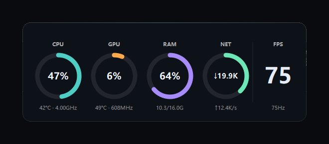
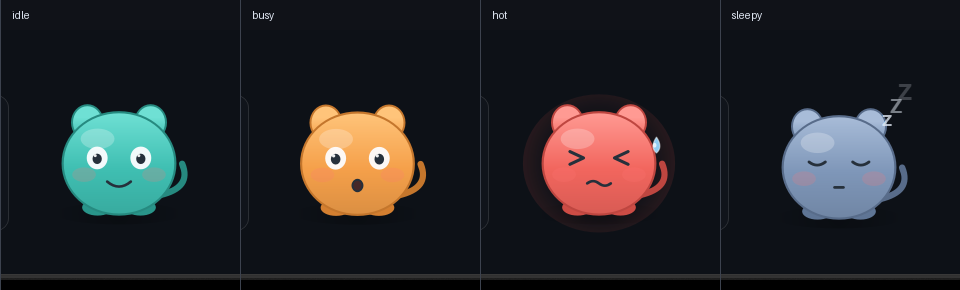

# 系统信息桌宠（Windows 上位机）

常驻桌面的实时系统监控面板：CPU / GPU / RAM / 网络 用圆环显示，附带温度、频率、FPS。

采集层从第一天起就按「可迁移到 STM32」的方式设计：数据结构是纯 POD，将来加串口只加一个输出端，前面代码一行不动。



---

## 一、快速开始

**双击 `build.bat`** → 编译完成后再**双击 `run.bat`** 启动。

或者直接用编译好的程序：`build\bin\SystemInfoPet.exe`（已用 windeployqt 部署，可单独拷走）。

### 操作

| 动作 | 效果 |
|---|---|
| 左键拖动面板 | 移动位置，退出后自动记住 |
| 右键面板 | 弹出菜单 |
| 左键/右键托盘图标 | 弹出菜单 |
| 菜单「显示桌宠」 | 打开/关闭桌面上的小宠物（默认关闭） |
| 菜单「退出」 | 关闭程序 |

> 面板位置会存进注册表 `HKCU\Software\b-as-h\SystemInfoPet`。多显示器换位置后会按保存的坐标恢复，若跑出屏幕会自动夹回来。

---

## 二、显示的数据

对应参考监控屏的全部字段，改成圆环呈现：

| 环 | 主数值 | 环下方小字 |
|---|---|---|
| **CPU** | 占用率 % | 温度 °C · 当前频率 GHz |
| **GPU** | 占用率 % | 温度 °C · 频率 MHz |
| **RAM** | 占用率 % | 已用 / 总量 GB |
| **NET** | 下行速率 | 上行速率 |
| **FPS** | 帧率大字 | 显示器刷新率 Hz |

### 各字段从哪来

| 数据 | 来源 | 说明 |
|---|---|---|
| CPU 占用 | `GetSystemTimes()` | 差分法，kernel 已含 idle 必须减掉 |
| CPU 频率 | PDH `\Processor Information(_Total)\% Processor Performance` × 注册表 `~MHz` | 睿频时超过 100%，读数 4.0GHz 以上 |
| 内存 | `GlobalMemoryStatusEx()` | 与任务管理器同源（`dwMemoryLoad`） |
| GPU 占用 | PDH `\GPU Engine(*)\Utilization Percentage` | **AMD / Intel / NVIDIA 通用**，不依赖 NVML |
| 网络 | `GetIfTable2()` | 必须过滤 NDIS 过滤驱动接口，见第五节 |
| 磁盘 | `GetDiskFreeSpaceExW()` | 系统盘 |
| FPS | `DwmGetCompositionTimingInfo()` | 桌面合成帧率，见下方说明 |
| CPU/GPU 温度、GPU 频率 | **HWiNFO 共享内存** | 需要装 HWiNFO，见第四节 |

### 关于 FPS 的说明（别当成游戏帧率）

`DWM_TIMING_INFO` 里的帧计数**不是**每个 vblank 都 +1，只在桌面真有内容更新时才递增。实测桌面完全静止时，2 秒内 `cFrame` 只 +1，`cFramesDisplayed` 甚至不动。

所以这里的实现是：

- 有内容更新（动画、窗口化游戏、拖动窗口）→ 显示**实测合成帧率**
- 连续静止 → 回落到**刷新率**（显示器确实在以这个频率刷新）

**测不到的情况**：游戏用独占全屏会绕过 DWM，此时读到的是刷新率而不是游戏帧率。想要游戏内真实 FPS 必须接 PresentMon / RTSS，那是另一套东西。

---

## 三、桌宠（默认隐藏）

主界面是圆环面板，桌面小宠物默认不显示，从托盘菜单「显示桌宠」可以打开。代码完整保留，没有删除。


四种情绪（负载驱动，带迟滞，进 70% / 退 60%，且持续数秒才切换）：



- **idle** 青绿、微笑
- **busy** 橙色、张嘴、轻微抖动（负载 ≥70%）
- **hot** 红色、挤眼、冒汗（负载 ≥85%）
- **sleepy** 灰蓝、闭眼、飘 Z（5 分钟无交互且负载 <15%）

---

## 四、温度需要 HWiNFO

CPU 核心温度来自 MSR 寄存器，**读它需要内核权限**。用户态程序一律读不到，必须借 HWiNFO 或 LibreHardwareMonitor 这类自带驱动的工具。这跟代码水平无关，是 Windows 的权限模型决定的。

实测本机 `MSAcpi_ThermalZoneTemperature` 直接返回「拒绝访问」，而且即使提权，桌面主板返回的通常也是 ACPI 热区温度而非核心温度。

### 开启步骤

1. 安装 [HWiNFO](https://www.hwinfo.com/)
2. 打开 **Settings → Safety**，勾选 **Shared Memory Support**
3. 保持 HWiNFO 在后台运行

程序每 5 秒自动尝试连接一次，**不需要重启本程序**。没装 HWiNFO 时温度显示 `—`，这是正常情况不是错误。

### 已知限制

HWiNFO **免费版共享内存在 12 小时后会冻结**（数据不再更新）。程序做了新鲜度检测：`poll_time` 连续 15 秒不前进就判定为冻结，温度自动变回 `—`，不会挂着一个不动的旧值。

要长期无限制，可以改用 **LibreHardwareMonitor**（开源免费），但要走 COM 调它的 WMI 命名空间——注意 **MinGW 不支持 C++/CLI**，没法直接调它的 .NET 库。

### 解析逻辑是验证过的

本机没装 HWiNFO，但解析代码不能"没测过就上线"。用一个假共享内存生成器（写入与 HWiNFO 相同的结构）验证过打分选优：

| 输入读数 | 期望选中 | 实际 |
|---|---|---|
| `CPU Package` 42 / `CPU Core Max` 45 | 42（Package 优先） | ✅ 42.0 |
| `GPU Temperature` 49 / `GPU Hot Spot` 60 | 49（Hot Spot 降权） | ✅ 49.0 |
| `GPU Clock` 608 | 608 | ✅ 608 |

---

## 五、踩坑记录

### 1. 中文路径下 moc 无法生成文件（本项目最大坑）

工程位于 `E:\上位机\系统信息`，路径含中文。实测：

- `g++` 读写中文路径 ✅
- CMake / Ninja 中文路径 ✅
- **`moc.exe` 无法把文件【写到】中文路径** ❌

报错：`moc: Cannot create ... Error: Permission denied`
（注意：moc **读**中文路径的源文件是正常的，只有输出路径有限制。）

**解决**：把 AUTOGEN 产物重定向到纯 ASCII 目录：

```cmake
set_target_properties(SystemInfoPet PROPERTIES
    AUTOGEN_BUILD_DIR "$ENV{TEMP}/SystemInfoPet_autogen")
```

> 只设 `CMAKE_AUTOGEN_BUILD_DIR` 变量在某些 CMake 版本下不生效，必须同时设目标属性。

### 2. MinGW 下 `GetIfTable2` 报未声明

两层原因，缺一不可：

1. 它声明在 `netioapi.h`，不是 `iphlpapi.h`（MSVC 会自动带，MinGW 不会）
2. 它被 `#ifdef _WS2IPDEF_` 守卫，而**先包含 `iphlpapi.h` 会让 `netioapi.h` 跳过 `ws2ipdef.h`**

正确顺序（`NetSource.cpp` 已固定）：

```cpp
#include <winsock2.h>
#include <ws2ipdef.h>   // 必须在 iphlpapi.h 之前
#include <windows.h>
#include <iphlpapi.h>
#include <netioapi.h>
```

另外 CMake 里要全局定义 `_WIN32_WINNT=0x0A00` 和 `NTDDI_VERSION=0x0A000006`。

### 3. 网络会重复计数

`GetIfTable2` 返回的不只是物理网卡。本机实测 37 条记录，一块 Realtek 被拆成 **5 条**：本体 + `WFP Native MAC Layer LightWeight Filter` + `QoS Packet Scheduler` + `WFP 802.3 MAC Layer ...`。

这些过滤接口 `Type` 同样是 6、状态同样 Up，**只看类型和状态根本筛不掉**，流量会被重复累加数倍。必须判断：

```cpp
if (!r.InterfaceAndOperStatusFlags.HardwareInterface) return false;
if (r.InterfaceAndOperStatusFlags.FilterInterface)    return false;
```

### 4. PDH 计数器句柄必须保存

`PdhAddCounterW` 的第四个参数传 `nullptr` 能加进去，但之后取值会直接**段错误**。必须把每个 `PDH_HCOUNTER` 存下来。

另外 `PdhExpandWildCardPathW` 返回的是多字符串（`\0` 分隔、双 `\0` 结尾），遍历要用**有界循环**，用 `wcslen` 裸跑会越界崩溃。引擎名是 `3D`（大写），写 `3d` 恒为 0。

### 5. 窗口位置恢复的时机

在构造函数里 `move()` 是**延迟应用**的，`showEvent` 里读 `frameGeometry()` 拿到的还是 `(0,0)`，边界校验形同虚设。

必须在 `showEvent` 里直接用**存下来的坐标值**做钳制，而不是读窗口当前几何。

### 6. 半透明背景会透出桌面文字

面板背板用 `alpha=250` 时，桌面上的文字会以约 2% 透出来，在深色壁纸上看着像重影。改用不透明色后干净了，圆角仍由 QPainter 抗锯齿处理。

### 7. `GetSystemTimes` 的两个坑

- **第一次采样必须丢弃**：返回的是开机以来累计值，没有前值可比
- **kernel time 已包含 idle time**：`total = kernel + user`，`busy = total - idle`。忘了减 idle 占用率会永远偏低

### 8. `.bat` 必须 CRLF + 纯 ASCII

用 LF 换行配中文注释，cmd 会解析错乱，报 `'ATH' 不是内部或外部命令`。

---

## 六、调试开关

程序是 WIN32 子系统（无控制台），排查靠环境变量：

| 变量 | 作用 |
|---|---|
| `SIP_DEBUG=1` | 在 exe 同目录生成 `sip_debug.log`，每秒记录全部采集值和窗口状态 |
| `SIP_MOOD=idle\|busy\|hot\|sleepy` | 强制桌宠情绪，方便截图检查表情 |
| `SIP_PET=1` | 启动时就显示桌宠（默认隐藏） |

```bat
set SIP_DEBUG=1
build\bin\SystemInfoPet.exe
```

---

## 七、测试记录

| 项目 | 方法 | 结果 |
|---|---|---|
| CPU 准确性 | 8 进程打满 6 秒 | 稳定读到 100.0%，回落正常 |
| GPU 采集 | AMD R7 430 实机 | 读到真实占用（1–54% 波动），未用 NVML |
| 温度解析 | 假 HWiNFO 共享内存 | CPU 42 / GPU 49 / GPU 608MHz 全部正确 |
| FPS | 静止 / 有动画 | 静止显示 75Hz，有更新时显示实测合成帧率 |
| 内存稳定性 | 连续运行 125 秒 | 稳定 36.2MB，无增长 |
| 窗口标志 | 读 `GetWindowLongPtr` | `0x80088`（TOOLWINDOW\|LAYERED\|TOPMOST），不进任务栏 |
| 多显示器 | 主屏 + 虚拟屏 | 位置保存/恢复正确，跑出屏幕会夹回 |

---

## 八、目录结构

```
系统信息/
├── CMakeLists.txt
├── build.bat / run.bat
├── docs/                    预览截图
└── src/
    ├── main.cpp
    ├── core/                采集层（与 UI 完全解耦）
    │   ├── Metrics.h        纯 POD，将来原样进 STM32
    │   ├── IDataSource.h    采集接口
    │   ├── WinSource.cpp    CPU / 内存 / 自身占用
    │   ├── FreqSource.cpp   CPU 频率（PDH）
    │   ├── GpuSource.cpp    GPU 占用（PDH）
    │   ├── NetSource.cpp    网络（需过滤 NDIS 接口）
    │   ├── DiskSource.cpp   磁盘
    │   ├── DwmSource.cpp    FPS / 刷新率
    │   ├── HwinfoSource.cpp 温度 / GPU 频率（HWiNFO 共享内存）
    │   ├── MetricsHub.cpp   工作线程 + 聚合
    │   └── SerialSink.cpp   串口输出（预留）
    ├── pet/
    │   ├── PetState.cpp     情绪状态机（带迟滞）
    │   ├── PetRenderer.cpp  QPainter 绘制角色
    │   └── PetWindow.cpp    透明窗口 + 拖动
    └── ui/
        ├── RingPanel.cpp    圆环仪表盘
        └── TrayIcon.cpp     托盘菜单
```

---

## 九、架构要点

### `Metrics` 是唯一的耦合点

```cpp
struct Metrics {   // 纯 POD，不含任何 Qt / Win32 类型
    float cpuUsage, memUsage, gpuUsage;
    float cpuTemp, gpuTemp, cpuFreqMHz, gpuClockMHz;
    float netDownKBs, netUpKBs, ramUsedGB, ramTotalGB;
    float fps, refreshHz, diskUsedPct, selfMemMB;
    uint64_t tsMs;      // uint64，不是 uint32：49.7 天会溢出
};
```

左边是「数据从哪来」，右边是「数据到哪去」。加一个数据源不用改任何现有代码。

### 采集在工作线程，靠信号槽传值，不用锁

```
Collector（工作线程，1Hz）──emit Metrics──▶ MetricsHub（主线程）──▶ 圆环 / 桌宠
```

`Metrics` 注册了 `Q_DECLARE_METATYPE`，跨线程 emit 时 Qt 自动排队并深拷贝。
主线程拿到的永远是完整一致的快照，不会出现「CPU 是新值、GPU 是旧值」的撕裂，也不需要 mutex。

### 串口协议（接 STM32 用，尚未启用）

15 字节定长帧，MCU 端不需要 JSON 解析器：

```
AA 55 | ver | cpu | mem | gpu | cpuTemp | gpuTemp | netDown(2) | netUp(2) | cpuFreq/100 | fps | crc8
  2      1     1     1     1       1         1          2            2            1          1     1
```

- 多字节字段小端
- `0xFF` 表示无数据
- CPU 频率以 100MHz 为单位
- CRC-8/ATM，多项式 0x07，覆盖前 14 字节
